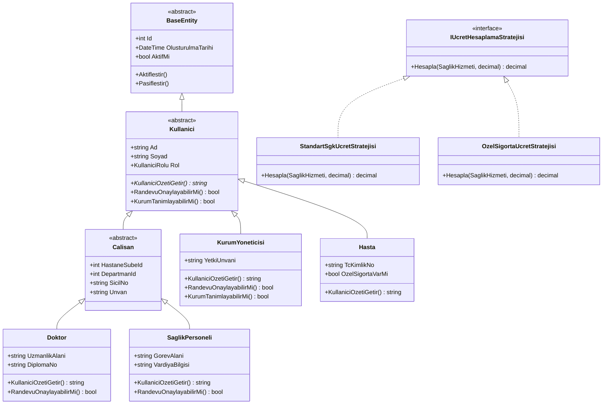

# Hastane / Klinik Randevu Sistemi (`nesneye-dayali-programlama-dilleri-odev-yl`)

Sakarya Üniversitesi Yüksek Lisans **Nesneye Dayalı Programlama Dilleri** dersi kapsamında **.NET 10.0 LTS**, **ASP.NET Core MVC** ve **Entity Framework Core (SQLite)** kullanılarak geliştirilmiş çok katmanlı (N-Tier / Clean Architecture) Hastane ve Klinik Randevu Sistemi.

---

## 1. Mimari Yapı ve Katmanlar

Çözüm (`HastaneRandevuSistemi.sln`) **Dependency Inversion Prensibi (DIP)** doğrultusunda 4 ana katmandan oluşmaktadır:

1. **`HastaneRandevuSistemi.Core`** *(Domain & Soyutlama Katmanı)*
   - Soyut sınıflar (`BaseEntity`, `Kullanici`, `Calisan`), somut varlıklar (`SaglikKurumu`, `HastaneSube`, `Departman`, `SaglikHizmeti`, `Doktor`, `SaglikPersoneli`, `KurumYoneticisi`, `Hasta`, `CalisanUygunluk`, `Randevu`), `IRepository<T>` / `IUnitOfWork` arayüzleri, `IUcretHesaplamaStratejisi` strateji desenleri ve domain istisnaları (`DomainException`, `RandevuCakismaException`, `YetkisizIslemException`).
2. **`HastaneRandevuSistemi.DataAccess`** *(Veri Erişim Katmanı)*
   - Entity Framework Core `AppDbContext` (TPT - Table Per Type kalıtım eşlemesi), özelleşmiş Repository (`RandevuRepository`, `DoktorRepository`, `HastaneSubeRepository`, `SaglikHizmetiRepository`) & `UnitOfWork` implementasyonları ve örnek başlangıç verilerini otomatik yükleyen `DataSeeder`.
3. **`HastaneRandevuSistemi.Business`** *(İş Mantığı Katmanı)*
   - Doğrudan `AppDbContext` bağımlılığı olmadan yalnızca `IUnitOfWork` soyutlaması üzerinden çalışan iş servisleri (`RandevuService`, `KurumYonetimService`).
4. **`HastaneRandevuSistemi.WebUI`** *(Sunum Katmanı - ASP.NET Core MVC)*
   - Kurum/şube/bölüm/hizmet tanımlama, doktor/sağlık personeli/hasta kaydı, uygunluk takvimi yönetimi, çakışma kontrollü randevu oluşturma, şube/doktor/durum bazlı filtreleme ve polimorfik onay süreçlerini sunan MVC arayüzü.

---

## 2. OOP Sınıf Diyagramı (Class Diagram)

---

## 3. Ödev Gereksinimleri Karşılama Tablosu

| Ödev Gereksinimi | Uygulanan Sınıf / Metot |
| :--- | :--- |
| **Tek ve Çok Şubeli Hastane/Klinik Tanımı** | `SaglikKurumu`, `HastaneSube`, `KurumYonetimService.SubeOlusturAsync()` |
| **Çalışma Saatleri ve Bölüm Tanımları** | `HastaneSube.CalismaSaatleriniAyarla()`, `Departman`, `DepartmanOlusturAsync()` |
| **Sağlık Hizmeti, Süre ve Ücret Tanımı** | `SaglikHizmeti.HizmetBilgileriniAyarla()`, `IUcretHesaplamaStratejisi` |
| **Doktor ve Sağlık Personeli Kaydı** | `DoktorKaydetAsync()`, `SaglikPersoneliKaydetAsync()`, `DoktoraHizmetTanimlaAsync()` |
| **Doktor Uygunluk Zaman Dilimleri** | `CalisanUygunluk.ZamanDilimiAyarla()`, `ZamanDilimiUygunMu()` |
| **Randevu Çakışma Kontrolü** | `Randevu.ZamanCakisiyorMu()`, `RandevuService.RandevuOlusturAsync()` |
| **Randevu Onay / Red / Tamamlama Mekanizması** | `Randevu.Onayla()`, `Randevu.Reddet()`, `Randevu.Tamamla()`, `Randevu.IptalEt()` |
| **Kullanıcı Rolleri ve Şube Bazlı İzolasyon** | `SistemYoneticisi`, `KurumYoneticisi`, `Doktor`, `SaglikPersoneli`, `Hasta` (`Kullanici` soyut sınıfı) |

---

## 4. Detaylı Proje Raporu

Projenin özeti, amacı, kullanılan teknolojiler, TPT veritabanı tasarımı, 4 katmanlı OOP mimarisi, uygulama modülleri ve karşılaşılan teknik sorunların çözümlerini içeren kapsamlı akademik proje raporu için:
- **[Nesneye Dayalı Programlama Dilleri Proje Raporu - PDF (`docs/PROJE_RAPORU.pdf`)](docs/PROJE_RAPORU.pdf)**
- **[Nesneye Dayalı Programlama Dilleri Proje Raporu - Markdown (`docs/PROJE_RAPORU.md`)](docs/PROJE_RAPORU.md)**

---

## 5. Kurulum ve Çalıştırma (Visual Studio / .NET CLI)

1. `HastaneRandevuSistemi.sln` dosyasını **Visual Studio** ile açın.
2. Başlangıç projesi (Startup Project) olarak **`HastaneRandevuSistemi.WebUI`** projesini seçin ve **F5** (veya `dotnet run --project src/HastaneRandevuSistemi.WebUI`) ile çalıştırın.
3. İlk çalıştırmada SQLite veritabanı (`HastaneRandevuSistemi.db`) ve örnek hastane/klinik, doktor, sağlık personeli, hasta, uygunluk takvimi ve randevu verileri otomatik olarak oluşturulur.
