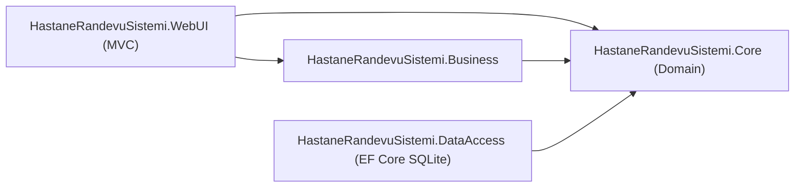
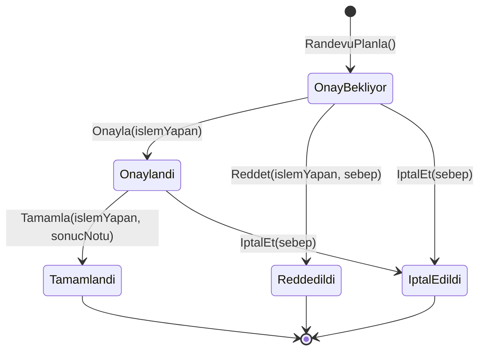
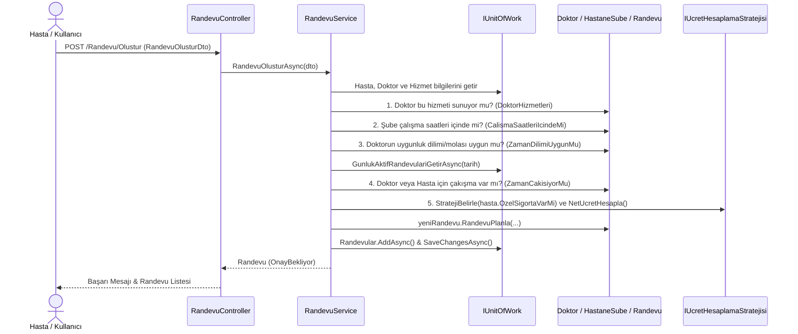

# Mimari Tasarım, OOP İlkeleri ve Sunum Rehberi

Bu doküman, **Hastane / Klinik Randevu Sistemi** projesinde uygulanan Nesneye Dayalı Programlama (OOP) ilkelerini, SOLID prensiplerini, tasarım desenlerini ve iş akışı diyagramlarını açıklamaktadır.

---

## 1. Katmanlı Mimari ve Bağımlılık Yönü (DIP)

Projede **Dependency Inversion Principle (DIP)** uygulanarak `Business` katmanının somut veri erişim teknolojisine (`EF Core` / `SQLite`) olan bağımlılığı kaldırılmış; tüm katmanlar `Core` katmanındaki soyutlamalar (`IUnitOfWork`, `IRepository<T>`, `IUcretHesaplamaStratejisi`) etrafında kurgulanmıştır.

---

## 2. Randevu Yaşam Döngüsü (State Diagram)

[`Randevu`](../src/HastaneRandevuSistemi.Core/Entities/Randevu.cs) varlığı içerisindeki `Durum` (`RandevuDurumu`) özelliği `private set` ile kapsüllenmiş olup yalnızca ilgili domain davranış metotları aracılığıyla durum değiştirebilir:

---

## 3. Randevu Oluşturma ve Çakışma Kontrolü Akışı (Sequence Diagram)

---

## 4. Uygulanan OOP İlkeleri, SOLID ve Tasarım Desenleri Özeti

### A. Temel OOP İlkeleri
1. **Soyutlama (Abstraction):** `BaseEntity`, `Kullanici` ve `Calisan` sınıfları `abstract` olarak tanımlanmış; ortak özellikler ve alt sınıfların ezmek zorunda olduğu (`abstract string KullaniciOzetiGetir()`) sözleşmeler belirlenmiştir.
2. **Kalıtım (Inheritance):** `Hasta`, `KurumYoneticisi` ve `Calisan` (`Doktor`, `SaglikPersoneli`) sınıfları `Kullanici` sınıfından türetilmiştir. Veritabanında **TPT (Table Per Type)** stratejisiyle modellenmiştir.
3. **Çok Biçimlilik (Polymorphism):**
   - `Kullanici.RandevuOnaylayabilirMi()`: `Hasta` için `false`, `Doktor`, `SaglikPersoneli` ve `KurumYoneticisi` için `true` döner.
   - `Kullanici.KurumTanimlayabilirMi()`: Yalnızca `KurumYoneticisi` için `true` döner.
   - `IUcretHesaplamaStratejisi.Hesapla()`: Hastanın sigorta durumuna göre farklı fiyatlandırma davranışı sergiler.
4. **Kapsülleme (Encapsulation):** `HastaneSube.AcilisSaati`, `SaglikHizmeti.SureDakika`, `CalisanUygunluk.BaslangicSaati` ve `Randevu.Durum` gibi kritik alanlar dışarıdan doğrudan değiştirilemez (`private set`); yalnızca doğrulama yapan metotlarla (`CalismaSaatleriniAyarla`, `HizmetBilgileriniAyarla`, `ZamanDilimiAyarla`, `RandevuPlanla`) güncellenebilir.

### B. Tasarım Desenleri (Design Patterns)
- **Generic Repository & Özelleşmiş Repository Pattern:** Veri erişim sorgularını (`Include`, filtreleme, Soft Delete) merkezi hale getirir.
- **Unit of Work Pattern:** İşlemleri tek bir iş birimi altında toplayarak atomik olarak veritabanına yansıtır.
- **Strategy Pattern:** `StandartSgkUcretStratejisi` ve `OzelSigortaUcretStratejisi` ile Open/Closed Prensibine (OCP) uygun dinamik ücret hesaplaması sağlar.

---

## 5. Sunum İçin Önerilen Canlı Demo Akışı

1. **Ana Panel (`/`):** Çok şubeli kurum yapısını, doktorların uygunluk takvimlerini ve en alttaki tabloda yer alan polimorfik `KullaniciOzetiGetir()` çıktılarını gösterin.
2. **Kurum & Çalışan Tanımlama (`/KurumYonetim`):**
   - Üstteki **Aktif İşlem Yapan Kullanıcı** seçicisinden bir `Hasta` seçip şube eklemeyi deneyerek polimorfik `YetkisizIslemException` uyarısını gösterin.
   - Ardından `KurumYoneticisi` seçerek yeni bir şube, bölüm, sağlık hizmeti veya doktor ekleyin.
3. **Randevu Yönetimi ve Çakışma Kontrolü (`/Randevu`):**
   - Doktor seçildiğinde yalnızca o doktorun sunduğu hizmetlerin otomatik filtrelendiğini gösterin.
   - Aynı doktor ve aynı tarih/saat için ikinci kez randevu oluşturmayı deneyerek **`RandevuCakismaException`** kontrolünü canlı gösterin.
   - Öğle molası (ör. `12:30`) veya mesai dışı bir saat seçerek doktor uygunluk takvimi doğrulamasını gösterin.
4. **Randevu Onay ve Muayene Tamamlama (`/Randevu`):**
   - `OnayBekliyor` durumundaki bir randevuyu ilgili doktor veya yöneticiyle **Onayla** butonuna basarak onaylayın, ardından **Muayeneyi Tamamla** ile süreci tamamlayın.
