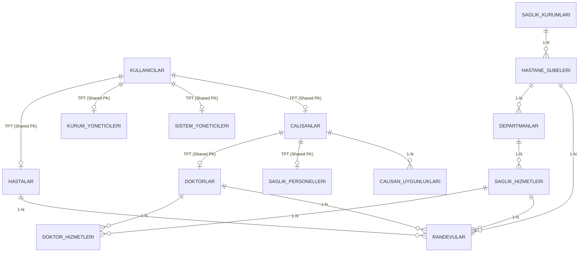
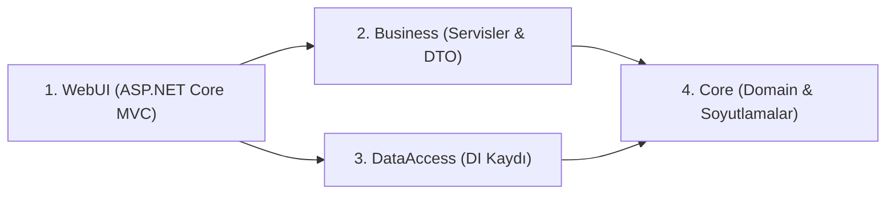
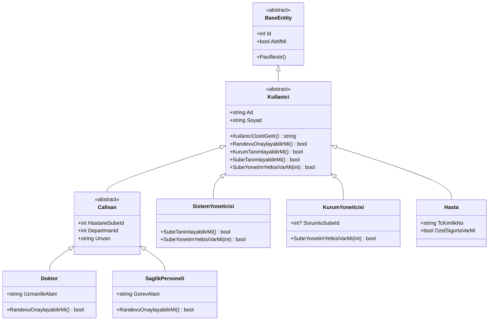

**T.C.**  
**SAKARYA ÜNİVERSİTESİ**  
**FEN BİLİMLERİ ENSTİTÜSÜ**  
**BİLGİSAYAR MÜHENDİSLİĞİ YÜKSEK LİSANS**

 

# NESNEYE DAYALI PROGRAMLAMA DİLLERİ ÖDEV RAPORU
### Çok Şubeli Hastane ve Klinik Randevu Yönetim Sistemi

 

**HAZIRLAYAN**  
**Enes SOYLU - Y265012073 – enes.soylu4@ogr.sakarya.edu.tr**  
**1. Öğretim A Grubu (Yüksek Lisans)**  
https://github.com/ByThePi/nesneye-dayali-programlama-dilleri-odev-yl

 

**Sakarya**  
**Kasım, 2026**

---

## 1. Özet

Sakarya Üniversitesi Yüksek Lisans **Nesneye Dayalı Programlama Dilleri** dersi kapsamında geliştirilen bu projenin temel amacı; hem tekil polikliniklerin hem de çok şubeli sağlık kuruluşlarının kurumsal yönetim, poliklinik/hizmet tanımlama, hekim çalışma takvimi planlama ve hasta randevu süreçlerini uçtan uca dijitalleştiren, nesneye dayalı programlama (OOP) ilkelerine dayalı bir yazılım ürünü ortaya koymaktır. Geleneksel randevu ve poliklinik takip yöntemlerinde karşılaşılan zaman çakışmaları, şubeler arası yetki karmaşası ve manuel fiyatlandırma hataları bu sistem ile giderilmiştir.

Uygulama, **4 Katmanlı Mimari (Clean / N-Tier Architecture)** ve **Model-View-Controller (MVC)** tasarım deseni kullanılarak **.NET 10.0 LTS** platformunda geliştirilmiştir. Projenin arka planında (Back-End), Nesneye Dayalı Programlama ilkeleri (**Soyutlama, Kalıtım, Çok Biçimlilik, Kapsülleme**) ve **SOLID** prensipleri doğrudan domain modeline yansıtılmış; ilişkisel veritabanı katmanında ise **TPT (Table-Per-Type)** kalıtım stratejisi ile Kurum, Şube, Poliklinik (Departman), Sağlık Hizmeti, Doktor, Sağlık Personeli, Hasta ve Randevu tabloları birbiriyle tam bütünleşik çalışacak şekilde tasarlanmıştır.

Geliştirilen sistem sayesinde; **Genel Merkez Sistem Yöneticisi (Ana Admin)** yeni hastane/klinik şubeleri açabilmekte ve her şubeye ayrı yönetici atayabilmekte, **Şube Yöneticileri** yalnızca kendi sorumlu oldukları hastanenin poliklinik, hizmet ve hekim kadrosunu yönetebilmekte, **Hastalar** ise hekimlerin uygunluk zaman dilimleri doğrultusunda çakışma kontrolünden geçerek 7/24 güvenli biçimde randevu alabilmektedir.

---

## 2. Giriş

### a. Projenin Konusu ve Önemi

Günümüzde bilişim teknolojilerinin hızla gelişmesi, sağlık sektöründeki operasyonel ve yönetimsel süreçleri köklü bir şekilde değiştirmiştir. Sağlık kuruluşlarının hizmet kalitesini artırabilmeleri ve hasta memnuniyetini üst düzeyde tutabilmeleri, dijital dönüşüm süreçlerine uyum sağlamalarıyla doğrudan ilişkilidir.

Özellikle birden fazla şubesi, polikliniği ve uzman hekimi bulunan sağlık kuruluşlarında; hekim çalışma saatlerinin, öğle molalarının, işlem sürelerinin ve sigorta kapsamına göre değişen muayene ücretlerinin manuel yöntemlerle veya bütünleşik olmayan araçlarla takip edilmesi ciddi operasyonel sorunlara yol açmaktadır. Aynı saat dilimine birden fazla randevu verilmesi (zaman çakışması), doktorun sunmadığı bir tıbbi işlemin yanlışlıkla seçilmesi veya bir şube yöneticisinin başka bir şubenin verilerine müdahale edebilmesi hem kurum içi denetimi zorlaştırmakta hem de hasta mağduriyetine neden olmaktadır.

Bu proje kapsamında geliştirilen **Hastane ve Klinik Randevu Yönetim Sistemi**, sağlık kuruluşlarının şube, poliklinik, çalışan ve randevu süreçlerini nesneye dayalı bir yazılım mimarisi üzerinde otomatize etmeyi ve insan kaynaklı hataları ortadan kaldırmayı konu almaktadır.

### b. Projenin Amacı

Projenin temel amacı, nesneye dayalı programlama prensiplerini somut, ölçeklenebilir ve güvenli bir kurumsal web uygulamasına dönüştürerek aşağıdaki hedefleri gerçekleştirmektir:

- **Çok Şubeli ve Kademeli Kurumsal Yönetim:** Hem tek bir kliniğin hem de çok şubeli bir hastane zincirinin desteklenmesi; Genel Merkez Yöneticisi ile Şube Yöneticisi rollerinin birbirinden izole edilerek her yöneticinin yalnızca kendi yetki sınırları içinde işlem yapabilmesini sağlamak.
- **Akıllı Randevu ve Çakışma Otomasyonu:** Hekimlerin uzmanlık alanları, sundukları sağlık hizmetleri, işlem süreleri ve gün bazlı uygunluk/mola saatleri doğrultusunda; çakışma ve geçmiş tarih doğrulamalarından geçen hatasız bir randevu planlama mekanizması kurmak.
- **Dinamik Ücretlendirme ve Onay Süreci:** Hastanın özel sağlık sigortası durumuna ve hekimin uzmanlık fark ücretine göre muayene/işlem tutarını çok biçimli (polymorphic) stratejilerle otomatik hesaplamak; oluşturulan randevuları onay, red, iptal ve muayene tamamlama yaşam döngüsüyle takip etmek.
- **Veri Güvenliği ve Rol Tabanlı Erişim Kontrolü:** Sistemdeki tüm ekranların ve işlemlerin kullanıcı rollerine (`SistemYoneticisi`, `KurumYoneticisi`, `Doktor`, `SaglikPersoneli`, `Hasta`) göre yetkilendirilmesini sağlamak ve yetkisiz URL erişimlerini engellemek.

### c. Projenin Kapsamı

Proje, modern kurumsal yazılım geliştirme standartlarına uygun olarak **4 ayrı katman (`Core`, `DataAccess`, `Business`, `WebUI`)** halinde tasarlanmıştır. Geliştirme sürecinde **Nesneye Dayalı Programlama (OOP)** ilkelerine, **Dependency Inversion (DIP)** ve **Open/Closed (OCP)** başta olmak üzere SOLID prensiplerine sadık kalınmıştır.

Uygulamanın arka yüzünde **ASP.NET Core MVC 10.0 LTS** ve **Entity Framework Core 10.0** ORM aracı tercih edilmiş; veri erişimi **Generic Repository** ve **Unit of Work** tasarım desenleri ile soyutlanmıştır. Ön yüzde (Front-End) ise **Bootstrap 5** kütüphanesi kullanılarak tüm cihazlarda (masaüstü, tablet, mobil) uyumlu çalışan, son kullanıcı odaklı bir arayüz geliştirilmiştir.

---

## 3. Kullanılan Teknolojiler ve Araçlar

Projenin geliştirilme sürecinde güncel, yüksek performanslı ve endüstri standardı teknolojiler tercih edilmiştir:

### a. Programlama Dili ve Framework

- **C# (.NET 10.0 LTS):** Projenin tüm katmanlarında güçlü tip güvenliği (strong typing), zengin nesne yönelimli programlama yetenekleri (`abstract class`, `interface`, `virtual/override`, `generics`, `LINQ`) ve asenkron programlama (`async/await`) desteği nedeniyle C# dili kullanılmıştır.
- **ASP.NET Core MVC 10.0:** Uygulamanın sunum katmanını oluşturmak için Microsoft'un geliştirdiği açık kaynaklı, platform bağımsız ve yüksek performanslı web çatısı tercih edilmiştir. MVC (Model-View-Controller) deseni sayesinde kullanıcı arayüzü ile iş mantığı birbirinden tamamen ayrılmıştır.

### b. Veritabanı ve ORM (Object-Relational Mapping)

- **SQLite (`HastaneRandevuSistemi.db`):** İlişkisel veritabanı yönetim sistemi olarak, harici sunucu kurulumu gerektirmeyen, taşınabilir ve ACID uyumlu SQLite veritabanı motoru kullanılmıştır.
- **Entity Framework Core 10.0:** Veritabanı işlemlerini nesne yönelimli bir yaklaşımla gerçekleştirmek amacıyla EF Core kullanılmıştır. Projede **Code-First** yaklaşımı ve **TPT (Table-Per-Type)** kalıtım haritalaması benimsenmiş; uygulama ilk kez çalıştırıldığında veritabanı şeması ve başlangıç (seed) verileri `DataSeeder` sınıfı tarafından otomatik olarak oluşturulacak şekilde kurgulanmıştır.

### c. Front-End Teknolojileri

- **HTML5 & CSS3:** Sayfa iskeleti ve kurumsal görsel düzenlemelerde güncel web standartları kullanılmıştır.
- **Bootstrap 5:** Form yapıları, veri tabloları, filtreleme çubukları, durum rozetleri (badges) ve navigasyon menülerinde duyarlı (responsive) tasarım sağlamak amacıyla kullanılmıştır.
- **Razor View Engine & JavaScript:** Sunucu taraflı modellerin dinamik HTML çıktısına dönüştürülmesi için Razor söz dizimi; randevu formunda seçilen hekime göre sunduğu sağlık hizmetlerinin anlık filtrelenmesi için istemci taraflı JavaScript kullanılmıştır.

### d. Kimlik Doğrulama ve Güvenlik

- **ASP.NET Core Cookie Authentication & Role-Based Authorization:** Kullanıcıların e-posta ve şifreleri ile güvenli oturum açabilmeleri için Cookie tabanlı kimlik doğrulama (`ClaimsPrincipal`) yapılandırılmıştır. `[Authorize]` ve `[Authorize(Roles = "SistemYoneticisi,KurumYoneticisi")]` nitelikleri ile rol bazlı sayfa erişim kısıtlamaları getirilmiş; yetkisiz erişim girişimleri özel **Erişim Engellendi (`/Hesap/ErisimEngellendi`)** ekranına yönlendirilmiştir.

### e. Geliştirme Ortamı (IDE) ve Versiyon Kontrolü

- **Visual Studio 2022 / .NET CLI:** Kod geliştirme, hata ayıklama (debugging) ve derleme süreçlerinde kullanılmıştır.
- **Git & GitHub:** Kaynak kodların versiyon kontrolü, özellik bazlı dal (`branch`) yönetimi ve aşamalı geliştirme takibi için Git ve GitHub kullanılmıştır.

---

## 4. Veritabanı Tasarımı

Veritabanı tasarımında OOP kalıtım hiyerarşisini ilişkisel modele veri tekrarı ve `NULL` sütun kirliliği olmadan yansıtmak amacıyla **TPT (Table-Per-Type)** stratejisi uygulanmıştır.

### Projede Kullanılan Temel Tablolar ve Görevleri

1. **`Kullanicilar` (Soyut Temel Tablo):**
   - Sistemdeki tüm kullanıcı rollerinin ortak kimlik ve iletişim bilgilerini tutar.
   - *Önemli Sütunlar:* `Id (PK)`, `Ad`, `Soyad`, `Email`, `Telefon`, `SifreHash`, `Rol`, `AktifMi`.
2. **`SistemYoneticileri` ve `KurumYoneticileri` (Yönetici Tabloları):**
   - Genel Merkez Yöneticilerinin (`YetkiKapsami`) ve Şube Yöneticilerinin (`SorumluSubeId`, `YetkiUnvani`) tutulduğu TPT alt tablolarıdır.
3. **`Calisanlar`, `Doktorlar` ve `SaglikPersonelleri` (Çalışan Kalıtım Tabloları):**
   - `Calisanlar` tablosu şube, bölüm, sicil numarası ve unvan bilgisini; `Doktorlar` tablosu `UzmanlikAlani` ve `DiplomaNo` bilgisini; `SaglikPersonelleri` tablosu ise `GorevAlani` ve `VardiyaBilgisi` verilerini saklar.
4. **`Hastalar`:**
   - Hastaların kimlik ve sigorta bilgilerini barındırır.
   - *Önemli Sütunlar:* `Id (PK/FK)`, `TcKimlikNo`, `DogumTarihi`, `KanGrubu`, `OzelSigortaVarMi`.
5. **`SaglikKurumlari` ve `HastaneSubeleri`:**
   - Ana sağlık kuruluşu ve ona bağlı hastane/klinik şubelerinin adres, şehir, telefon ve açılış-kapanış (`AcilisSaati`, `KapanisSaati`) bilgilerini tutar.
6. **`Departmanlar` (Poliklinikler) ve `SaglikHizmetleri`:**
   - Şubelerdeki tıbbi bölümleri (`Kardiyoloji`, `Radyoloji` vb.) ve bu bölümlerde sunulan tıbbi işlemleri (`HizmetAdi`, `HizmetTipi`, `SureDakika`, `TemelUcret`) tanımlar.
7. **`DoktorHizmetleri` (Çoka-Çok Eşleştirme Tablosu):**
   - Hangi doktorun hangi sağlık hizmetini sunduğunu ve o doktora özel ek uzmanlık fark ücretini (`DoktorId`, `SaglikHizmetiId`, `OzelUcretFarki`) saklar.
8. **`CalisanUygunluklari`:**
   - Doktorların haftanın hangi günlerinde, hangi mesai saatleri (`BaslangicSaati`, `BitisSaati`) ve öğle molası (`MolaBaslangic`, `MolaBitis`) aralıklarında hasta kabul ettiğini tutar.
9. **`Randevular`:**
   - Hasta, Doktor, Şube ve Sağlık Hizmeti arasındaki randevu kaydını, hesaplanan süreyi, toplam ücreti, hasta şikayet notunu ve onay/muayene durumunu saklar.
   - *Önemli Sütunlar:* `Id (PK)`, `HastaId (FK)`, `DoktorId (FK)`, `SaglikHizmetiId (FK)`, `HastaneSubeId (FK)`, `RandevuTarihi`, `BaslangicSaati`, `BitisSaati`, `SureDakika`, `ToplamUcret`, `Durum`, `HastaNotu`, `OnayNotu`.

### Veri Bütünlüğü ve İlişki Kuralları

- **One-to-Many (Bire-Çok):** Bir sağlık kurumunun birden fazla şubesi, bir şubenin birden fazla polikliniği, bir polikliniğin birden fazla sağlık hizmeti ve doktoru, bir doktorun ve hastanın birden fazla randevusu olabilir. Ana tablolar arasında `DeleteBehavior.Restrict` kullanılarak geçmiş randevuların bütünlüğü korunmuştur.
- **Many-to-Many (Çoka-Çok):** `Doktorlar` ve `SaglikHizmetleri` arasında `DoktorHizmetleri` ara tablosu üzerinden ek ücret farkı (`OzelUcretFarki`) taşıyan çoka-çok ilişki kurulmuştur.
- **Soft-Delete (Mantıksal Silme):** Silinen veya yetkisi kaldırılan kayıtlar fiziksel olarak silinmek yerine `Pasiflestir()` metodu ile `AktifMi = false` durumuna çekilerek tarihsel veri tutarlılığı korunmuştur.

---

## 5. Proje Mimarisi ve Uygulanan OOP İlkeleri

Proje, sorumlulukların net biçimde ayrıldığı **4 Katmanlı Mimari** üzerine inşa edilmiştir:

### Katmanların Görevleri

1. **`HastaneRandevuSistemi.Core` (Çekirdek / Domain Katmanı):** Hiçbir dış katmana bağımlılığı olmayan merkez katmandır. Soyut sınıflar (`BaseEntity`, `Kullanici`, `Calisan`), somut domain varlıkları, `IRepository<T>` ve `IUnitOfWork` arayüzleri, `IUcretHesaplamaStratejisi` strateji sınıfları ve özel domain istisnaları (`DomainException`, `RandevuCakismaException`, `YetkisizIslemException`) bu katmanda yer alır.
2. **`HastaneRandevuSistemi.DataAccess` (Veri Erişim Katmanı):** EF Core `AppDbContext` yapılandırmasını, `EfRepository<T>`, özelleşmiş repository sınıflarını (`RandevuRepository`, `DoktorRepository`, `HastaneSubeRepository`, `SaglikHizmetiRepository`), `UnitOfWork` sınıfını ve `DataSeeder` tohumlama mekanizmasını barındırır.
3. **`HastaneRandevuSistemi.Business` (İş Mantığı Katmanı):** Doğrudan `AppDbContext` sınıfına bağımlı olmadan yalnızca `IUnitOfWork` soyutlaması üzerinden çalışan iş servislerini (`RandevuService`, `KurumYonetimService`) ve veri transfer nesnelerini (`DTO`) içerir.
4. **`HastaneRandevuSistemi.WebUI` (Sunum Katmanı):** Kullanıcıdan gelen HTTP isteklerini karşılayan Controller sınıflarını (`HesapController`, `HomeController`, `KurumYonetimController`, `RandevuController`), ViewModel'leri ve Razor (`.cshtml`) görünümlerini içerir.

### Uygulanan Nesneye Dayalı Programlama (OOP) İlkeleri

- **Soyutlama (Abstraction):** `BaseEntity`, `Kullanici` ve `Calisan` sınıfları `abstract` olarak tanımlanmış; ortak özellikler ve alt sınıfların ezmek (`override`) zorunda olduğu sözleşmeler belirlenmiştir.
- **Kalıtım (Inheritance):** `SistemYoneticisi`, `KurumYoneticisi`, `Hasta` ve `Calisan` (`Doktor`, `SaglikPersoneli`) sınıfları 3 seviyeli bir kalıtım ağacı oluşturacak şekilde tasarlanmıştır.
- **Çok Biçimlilik (Polymorphism):**
  - *Metot Ezme (Method Overriding):* `SubeYonetimYetkisiVarMi(int hastaneSubeId)` metodu `SistemYoneticisi` için tüm şubelerde `true` dönerken, `KurumYoneticisi` için yalnızca kendi `SorumluSubeId` değeri eşleştiğinde `true`, diğer rollerde ise `false` döner.
  - *Arayüz Çok Biçimliliği (Strategy Pattern):* `IUcretHesaplamaStratejisi` arayüzünü uygulayan `StandartSgkUcretStratejisi` ve `OzelSigortaUcretStratejisi` (%25 indirim) sınıfları, çalışma zamanında hastanın sigorta durumuna göre seçilerek muayene ücretini çok biçimli olarak hesaplar.
- **Kapsülleme (Encapsulation):** `HastaneSube` çalışma saatleri, `SaglikHizmeti` süre/ücret alanları, `CalisanUygunluk` saatleri ve `Randevu` durum/ücret özellikleri `private set` ile dış müdahaleye kapatılmış; yalnızca iş kurallarını denetleyen davranışsal metotlar (`CalismaSaatleriniAyarla`, `HizmetBilgileriniAyarla`, `ZamanDilimiAyarla`, `RandevuPlanla`, `Onayla`, `Reddet`, `Tamamla`, `IptalEt`) üzerinden değiştirilebilir hale getirilmiştir.

---

## 6. Proje Modülleri

Uygulama, kullanıcı rollerine göre özelleştirilmiş dört ana modülden oluşmaktadır:

### a. Kimlik Doğrulama ve Hasta Kayıt Modülü (`/Hesap`)

- **Kullanıcı Girişi (`/Hesap/Giris`):** Sistemdeki 5 farklı rol (`SistemYoneticisi`, `KurumYoneticisi`, `Doktor`, `SaglikPersoneli`, `Hasta`) kurumsal veya kişisel e-posta ve şifreleri ile oturum açar. Test kolaylığı sağlamak adına giriş ekranında hazır demo hesapları tablosu da sunulmuştur.
- **Müstakil Hasta Kayıt Ekranı (`/Hesap/KayitOl`):** Hasta kayıt sıklığının yüksek olması nedeniyle hasta kayıt işlemi yönetim panelinden ayrılmış; TC Kimlik No (11 hane doğrulamalı), doğum tarihi, kan grubu ve özel sağlık sigortası bilgileriyle bağımsız bir kayıt ekranı oluşturulmuştur.
- **Yetkisiz Erişim Koruması (`/Hesap/ErisimEngellendi`):** Yönetici olmayan bir rol (örneğin `Hasta` veya `Doktor`) adres çubuğundan doğrudan `/KurumYonetim` adresine gitmeye çalıştığında sistem erişimi reddeder ve uyarı ekranına yönlendirir.

### b. Kurum, Şube ve Çalışan Yönetim Modülü (`/KurumYonetim`)

Yalnızca yönetici rollerinin erişebildiği bu modül, iki kademeli yetki mimarisiyle çalışır:

- **Genel Merkez Sistem Yöneticisi (Ana Admin) Yetkileri:**
  - Sisteme yeni hastane veya klinik şubesi (`SubeEkle`) ve çalışma saatleri tanımlama, mevcut şubeleri pasife alma (`SubeKaldir`).
  - Hastane şubelerine **Şube Yöneticisi** atama (`SubeYoneticisiEkle`) ve atanmış yöneticilerin yetkilerini kaldırma (`SubeYoneticisiYetkiKaldir`).
- **Şube Yöneticisi (Hastane Yöneticisi) Yetkileri:**
  - Yalnızca kendi sorumlu olduğu hastane şubesi kapsamında yeni poliklinik/bölüm (`DepartmanEkle`) ve süre/ücret detaylı sağlık hizmeti (`HizmetEkle`) tanımlama veya kaldırma.
  - Kendi hastanesine uzman doktor (`DoktorEkle`) ve sağlık personeli (`SaglikPersoneliEkle`) kaydetme, mevcut doktorlara ek sağlık hizmeti ve doktor fark ücreti eşleştirme (`DoktoraHizmetEkle`), doktorların gün bazlı çalışma ve öğle molası takvimini güncelleme (`UygunlukTanimla`) ve tanımlı kayıtları/eşleştirmeleri kaldırma.

### c. Hastaneler, Poliklinikler ve Hekimler Arama/Filtreleme Modülü (`/`)

Kullanıcıların tüm sağlık ağını inceleyebildiği ana modüldür:

- **Çok Kriterli Filtreleme:** Kullanıcılar **Hastane/Klinik Şubesi**, **Poliklinik/Bölüm**, **Hekim** seçerek veya **Hızlı Arama** kutusuna anahtar kelime yazarak şubeleri, bölümleri, işlem ücretlerini ve doktor çalışma saatlerini anlık olarak filtreleyebilir.

### d. Randevu Planlama, Çakışma Kontrolü ve Onay Modülü (`/Randevu`)

Projenin çekirdek operasyonel modülüdür:

- **Dinamik Hekim-Hizmet Seçimi ve Şikayet Notu:** Doktor seçildiğinde yalnızca o doktorun sunduğu tıbbi işlemler otomatik listelenir; hasta randevu tarihi, saati ve şikayet/randevu notunu (`HastaNotu`) girerek talebini oluşturur.
- **5 Aşamalı Sunucu Doğrulaması:**
  1. Doktorun seçilen hizmeti sunup sunmadığı kontrol edilir.
  2. Randevu başlangıç ve bitiş saatinin (`BaslangicSaati + SureDakika`) şube açılış-kapanış saatleri içinde olduğu doğrulanır.
  3. Doktorun o günkü mesai saatleri içinde olduğu ve öğle molası ile kesişmediği doğrulanır.
  4. Hem doktor hem de hasta için aynı gün ve saat aralığında çakışan başka bir aktif randevu olmadığı kontrol edilir (`ZamanCakisiyorMu`).
  5. Hastanın sigorta durumuna göre `IUcretHesaplamaStratejisi` ile toplam ücret hesaplanır.
- **Kronolojik Randevu Listesi ve Onay Yaşam Döngüsü:** Randevular tarihe göre kronolojik olarak sıralanabilir; şube, doktor ve duruma göre filtrelenebilir. Hastanın girdiği şikayet notu ve hekimin/kurumun girdiği onay/muayene açıklaması listede görüntülenir. Yetkili kullanıcılar randevuları **Onayla**, **Reddet**, **Muayeneyi Tamamla** veya **İptal Et** adımlarından geçirebilir.

---

## 7. Karşılaşılan Sorunlar ve Çözümleri

Projenin geliştirilme sürecinde karşılaşılan önemli teknik problemler ve uygulanan mühendislik çözümleri aşağıda özetlenmiştir:

- **Sorun 1: SQLite Veritabanında `TimeSpan` Veri Tipinin `ORDER BY` İfadesinde Desteklenmemesi**
  - *Açıklama:* Randevuların hem tarihe (`DateTime`) hem de başlangıç saatine (`TimeSpan`) göre sıralanması için EF Core üzerinde yazılan `.OrderBy(r => r.RandevuTarihi).ThenBy(r => r.BaslangicSaati)` sorgusu, SQLite sağlayıcısının `TimeSpan` ifadelerini doğrudan SQL `ORDER BY` yan tümcesine çevirememesi nedeniyle çalışma zamanında `NotSupportedException` hatasına yol açmıştır.
  - *Çözüm:* `RandevuRepository.TumRandevulariDetayliGetirAsync` metodunda tarih bazlı filtreleme ve çekme işlemi veritabanı tarafında tamamlandıktan sonra, saat bazlı (`TimeSpan`) ikincil kronolojik sıralama bellek içinde (`LINQ to Objects`) gerçekleştirilerek sorun çözülmüştür.

- **Sorun 2: Çok Şubeli Yapıda Şube Yöneticilerinin Yetki İzolasyonu**
  - *Açıklama:* Sistemde birden fazla hastane tanımlandığında, A hastanesinin yöneticisinin B hastanesinin polikliniklerine doktor/hizmet ekleyebilmesi veya tüm sisteme yeni hastane açabilmesi kurumsal güvenlik açığı oluşturmaktaydı.
  - *Çözüm:* `Kullanici` soyut sınıfına polimorfik `SubeTanimlayabilirMi()` ve `SubeYonetimYetkisiVarMi(int hastaneSubeId)` metotları eklenmiş; yeni hastane açma ve şube yöneticisi atama yetkisi yalnızca `SistemYoneticisi` (Genel Merkez Ana Admin) sınıfına verilmiş, `KurumYoneticisi` sınıfı ise yalnızca kendi `SorumluSubeId` değeriyle eşleşen şube verilerini görebilecek ve yönetebilecek şekilde sınırlandırılmıştır.

- **Sorun 3: Randevu Saat Aralığı Çakışmaları ve Öğle Molası Kesişimleri**
  - *Açıklama:* Yalnızca randevu başlangıç saatlerinin eşitliğini (`r.BaslangicSaati == talepBaslangic`) kontrol etmek, 30 veya 45 dakikalık işlemlerin devam ettiği ara dakikalara (örneğin `10:00 - 10:30` randevusu varken `10:15`'e) yeni randevu alınmasını engellememekteydi.
  - *Çözüm:* `Randevu` ve `CalisanUygunluk` domain sınıfları içerisine zaman aralığı kesişim formülü (`talepBaslangic < mevcutBitis && talepBitis > mevcutBaslangic`) kapsüllenmiş; böylece hem mevcut randevularla hem de doktorun öğle molası saatleriyle kısmi kesişmeler dahi eksiksiz biçimde engellenmiştir.

---

## 8. Sonuç ve Öneriler

Bu proje çalışması ile Sakarya Üniversitesi Yüksek Lisans **Nesneye Dayalı Programlama Dilleri** dersi kapsamında hedeflenen; çok katmanlı mimari tasarım, soyutlama, çok seviyeli kalıtım (TPT), çok biçimlilik, kapsülleme, tasarım desenleri (Repository, Unit of Work, Strategy) ve rol/şube bazlı güvenlik mekanizmaları somut bir **Hastane ve Klinik Randevu Yönetim Sistemi** üzerinde başarıyla hayata geçirilmiştir.

### Projenin Sağladığı Kazanımlar

1. Tekil kliniklerden çok şubeli hastane zincirlerine kadar ölçeklenebilen, Genel Merkez ve Şube Yöneticisi ayrımına sahip kurumsal bir yönetim altyapısı kurulmuştur.
2. Hekim uygunluk takvimi, işlem süresi ve zaman aralığı çakışma kontrolleri domain katmanında kapsüllenerek hatalı randevu oluşturulması tamamen önlenmiştir.
3. İş mantığı katmanı veri erişim teknolojisinden soyutlanarak (`IUnitOfWork`) sürdürülebilir, test edilebilir ve genişletilebilir bir kod tabanı elde edilmiştir.

### Gelecek İçin Geliştirme Önerileri

- **E-Nabız ve Merkezi Hekim Randevu Sistemi (MHRS) Web Servis Entegrasyonu:** Ulusal sağlık sistemleri ile RESTful API üzerinden çift yönlü veri senkronizasyonu sağlanması.
- **Otomatik Bildirim Servisi:** Randevu onaylandığında veya randevu saatine 24 saat kaldığında hastalara SMS ve E-Posta yoluyla hatırlatma bildirimleri gönderilmesi.
- **Online Ödeme ve Fatura Modülü:** Özel sigorta veya standart muayene fark ücretlerinin randevu onayı sonrasında çevrimiçi ödeme geçitleri (Iyzico/Stripe) üzerinden tahsil edilmesi.
